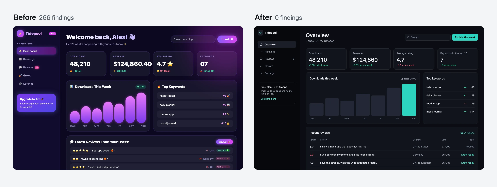
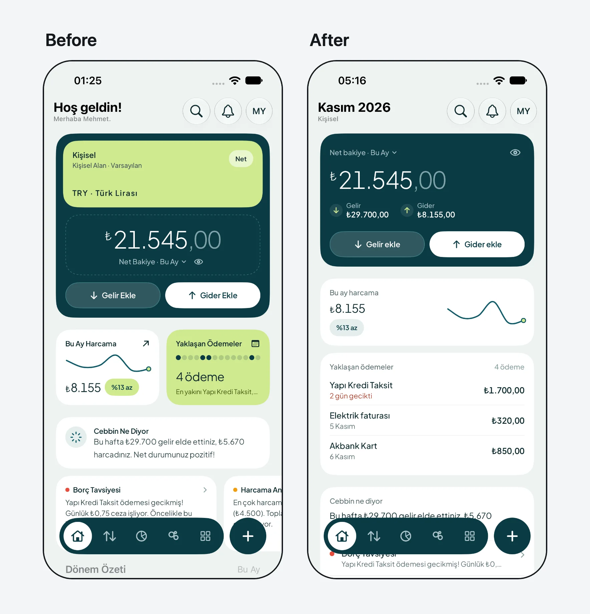

# ai-design-check

**AI が作ったインターフェースを「生成っぽく」見せている原因を見つけて修正し、再発を防ぎます。**

[](https://www.npmjs.com/package/@enmera/ai-design-check)
[](LICENSE)
[English](README.md) · [Türkçe](README.tr.md)

Claude Code、Cursor、Codex で開発するすべての人へ。141 のデザインルール、依存関係も API キーも不要なチェッカー、そして画面を修復するエージェントスキルを提供します。Web プロジェクト（React、Vue、Svelte、Laravel Blade、HTML。Tailwind、Bootstrap、素の CSS のいずれでも）と、SwiftUI、Jetpack Compose、Flutter、React Native のアプリを読み取れます。問題の検出にエージェントは不要で、機械的な修正にも必要ありません。

## 3 ステップで始める

**1. プロジェクトをチェックします。**

```bash
npx @enmera/ai-design-check
```

```
Accessibility (1)
src/pages/dashboard.tsx
     31  error  Never remove the focus ring without a replacement: outline-none  focus-ring-removed

Style (3)
src/pages/dashboard.tsx
     42  error  Font sizes from the scale only: text-[10px]  type-scale
     88  warn   No tracked uppercase labels: tracking-wide uppercase  no-decorative-uppercase

lang/tr.json
    812  error  Translation in Title Case: "Sıra Takibi" (Rank tracking)  sentence-case

1 accessibility, 3 style: 3 errors, 1 warnings, 0 notes.
```

**2. 答えが 1 つに決まるものは、エージェントなしで修正します。**

```bash
npx @enmera/ai-design-check --fix --dry-run
```

変更内容の一覧が表示されます。`--dry-run` を外すと実際に変更します。余白と角丸はスケール上の最も近い値に揃えられ、極端に太い文字は bold になります。タップ領域、色、絵文字、文言、階層は判断が必要なため、レポートに残ります。

**3. 残りはエージェントに修正させます。**

```bash
npx skills add enmerasoftware/ai-design-check
```

次に「この画面のデザインを直して」と頼みます。エージェントは画面を計測し、プロダクトに沿った短いブリーフを書いて修復し、修正前後の件数を示します。機能、データ、文言はそのまま残ります。

<p align="center">
  
</p>
<p align="center"><sub>同じダッシュボードの修正前と修正後です。<a href="examples/dashboard.html">修正前</a>と<a href="examples/dashboard.fixed.html">修正後</a>を開くか、<a href="examples/story-dashboard.mp4">動画</a>をご覧ください。</sub></p>

## パッケージの内容

| ツール | 答える問い | 実行方法 |
|---|---|---|
| **チェッカー** | どのファイルのどの行で、何が問題か？ | `npx @enmera/ai-design-check` |
| **修正スキル** | エージェントがこの画面を修復し、それを証明できるか？ | `npx skills add enmerasoftware/ai-design-check` |
| **`scan`** | 実行中のページには実際に何が表示されているか？ コントラスト、サイズ、何が何を覆っているか、スクリプトエラー | `npx @enmera/ai-design-check scan http://localhost:3000` |
| **`redesign`** | エージェントがこのページを調べ、各ステップを証明しながらブランチ上で作り直せるか？ | `npx @enmera/ai-design-check redesign http://localhost:3000` |
| **`inventory`** | ボタン、入力欄、見出し、カードは何種類あるか？ | `npx @enmera/ai-design-check inventory` |
| **`narrow`** | スマートフォンや文字列が長くなる言語で何が崩れるか？ | `npx @enmera/ai-design-check narrow page.html` |
| **`system`** | 新しいプロダクトは、どのフォント、文字サイズ、色から始めるべきか？ | `npx @enmera/ai-design-check system --brand "#1E5A63"` |
| **`story`** | 変更を動画で共有できるか？ | `npx @enmera/ai-design-check story before.html after.html` |

## 検出できること

67 のルールがコードを読み（うち 33 はアプリのコードも対象）、60 のルールが実行中のページを読みます（`scan`）。両方に当てはまるルールもあります。残りの 33 は画面を目で確認する必要があるため *review* として扱い、あなたと修正スキルに任せます。各ルールには、何をすべきか、その理由、修正方法が英語とトルコ語で書かれています：[RULES.md](RULES.md)。

| 分野 | 例 |
|---|---|
| アクセシビリティ | フォーカスリングを代替なしで消さない、アイコンだけのボタンにも名前を付ける、タップ領域 |
| スマートフォンのブラウザ | ピンチズームを無効にしない、入力欄の文字は 16 px、固定の `100vh` には `dvh` を併記、ホバーするまで隠さない |
| 文字と形状 | 11 px を下限とする 1 つの文字サイズスケール、階層ごとに 1 つの角丸、カードの中にカードを入れない |
| 文章とコピー | センテンスケース、字間を広げた大文字ラベルを使わない、バズワードを使わない、動作がわかるボタン、対処法がわかるエラー |
| コンポーネント | ボタンと入力欄は共有コンポーネントから、外部からのスタイル指定をしない、繰り返されるマークアップはコンポーネントにする |
| レイアウト | 4 px グリッドに沿った余白と階層ごとに 1 つの間隔、幅の広い表はページ全体に広げる、スマートフォンでも各セルに十分な幅 |
| ビジュアル言語 | 絵文字ではなく線画アイコン、グラデーション文字や紫のグラデーションを使わない、サイドのストライプを使わない、色付きの影を使わない、グローはグラフのみ |
| モーション | `transition-all` を使わない、バウンスを使わない、モーション軽減の設定を尊重する、パルスはライブデータのみ、反応は 300 ms 以内、終わりのないループを使わない |
| データ | 数値には比較対象を添える、等幅数字、空の状態 |
| ローカライズ | ロケールに応じた大文字・小文字の変換（トルコ語の i/İ）、数値はフォーマッター経由、正しい複数形 |
| セレクターとナビゲーション | セレクターの言語は 1 つに統一、メニューは目的別にグループ化、移動した URL はリダイレクトする |

ルールは、私たちが [Enmera](https://enmera.com.tr) と [Searvia](https://searvia.com) でリリースした画面から生まれました。何が生成っぽく見えたか、狭い幅で何が崩れたか、何が理解されなかったか。そのうえで、評価の高い 16 のダッシュボードデザインと比較しました。手法と結果：[RESEARCH.md](RESEARCH.md)。

**どれだけ見分けられるか。** [BENCHMARK.md](BENCHMARK.md) は、4 つの Claude モデルが Tailwind と Bootstrap で生成した 48 ページと、人がデザインした 34 サイトで、すべてのルールを実行します。はっきり見分けられるルールもあります。スマートフォンでは AI ページの 38% が横にスクロールしますが、人のサイトでは 1 件もありません。クリーム色の背景は 33% 対 3% です。紫のグラデーションのように、もう見分けられないルールもあり、その重大度はこの結果に合わせています。

## 実行中のページとリデザイン

`scan` は、モデルも API キーも使わずに、お使いの Chrome でページをデスクトップとスマートフォンの幅で開きます。ソースからはわからないもの、つまり実際のコントラスト、サイズ、何が何を覆っているか、壊れた画像、スクリプトエラー、いつまでも表示されないコンテンツを読み取ります。Chrome が計算するすべての色（Tailwind 4 の `oklch()` を含む）を読み、生成されたページによく見られる癖も見つけます。見出しの中で色を変えた 1 語、色付きの影、すべての行動喚起ボタンの末尾に付いた矢印、中黒（·）でつないだリスト、見出しの上に置かれたバッジです。

読み込めなかったページ、エラーを返したページ、サインインページへ転送されたページは、問題なしとはみなさず、終了コード 2 で止まります。サインインが必要なページには `--cookie "name=value"` や `--header "Name: value"` を渡します。シェルの履歴や CI のログに残したくない場合は、環境変数 `AI_DESIGN_CHECK_COOKIE` と `AI_DESIGN_CHECK_HEADERS` を使えます。そうしたページを意図して確認するには `--allow-redirect` や `--allow-status 404` を使います。複数の URL を渡すと 1 回の実行でまとめて確認します。プルリクエスト向けには `--format github` を付けます。設定に `designSystem`（`fonts`、`sizes`、`radii`、`colors`）があれば、そこから外れているものも指摘します。

`redesign` は、エージェント（Claude Code または Codex）が必要な唯一の機能です。ページが何を見せるべきかを決めるには判断が必要だからです。エージェントはスクリーンショット、コード、主題を調べ、セクションごとに 1 枚のカードを書きます。カードには、何を伝えているか、何が問題か、そのコンテンツ自体から生まれるアイデア、サイトから使う色を記します。カードは計測したページと照合されます。その後、番号付きの修正とカードが新しい git ブランチ上で 1 段階ずつ適用され、コンテンツが失われたり、ルールのエラーが増えたり、見た目が悪くなったりした段階は破棄されます。`--plan` はカードを書いた時点で止まるので、内容を読んで編集できます。`--brief` はそのカードをもとに実装します。作業ツリーがクリーンなときだけ開始し（先にコミットするか stash してください）、Ctrl-C を押すと途中の段階を元に戻します。

## モバイルアプリ

アプリのフォルダーを指定してください。SwiftUI と Jetpack Compose を読み取り、スケールから外れた余白（`spacing` を設定しない限り 4 pt。例：`.padding(13)`、`10.dp`）、スケールから外れた角丸、Dynamic Type を無視した固定テキスト、太すぎる見出し、紫のグラデーション、AI を表す `sparkles`、文字列内の絵文字、タイトルケースのラベル、重い影、大きなぼかし、ループするアニメーション、44 pt / 48 dp 未満のタップ領域を検出します。

```bash
npx @enmera/ai-design-check Cebbin/Views
```

<p align="center">
  
</p>
<p align="center"><sub>App Store で公開中の私たちの iOS アプリ Cebbin を、同じデータでシミュレーター上に表示したものです。<a href="examples/redesign-cebbin-swiftui.mp4">16 件の修正</a>を、それぞれの裏にある SwiftUI の行とともにご覧ください。または、23 件の指摘が 0 件になる<a href="examples/story-cebbin-swiftui.mp4">最初の実行</a>をご覧ください。</sub></p>

## プロジェクトで使う

### エージェントにルールを渡す

パッケージには 2 つのスキルが含まれており、どちらも `npx skills add enmerasoftware/ai-design-check` でインストールされます。

- **ai-design-check** は、エージェントが画面に手を加える前にルールを読み、その後でチェッカーを実行するようにします。
- **ai-design-fix** は、すでに生成っぽく見える画面を修復します。間隔と角丸を計測し、4 行のブリーフ（役割、主張、根拠、維持するもの）を書き、害の大きい順に画面を修正して、修正前後を報告します。件数を減らすためにコンテンツを削除することはなく、理由なしに指摘を黙らせることもありません。

Claude Code では、同じスキルをプラグインとしてインストールできます。`/plugin marketplace add enmerasoftware/ai-design-check` の後に `/plugin install ai-design-check@ai-design-check` を実行してください。Codex では `codex plugin marketplace add enmerasoftware/ai-design-check` を実行してください。

スキルを使わない場合は、エージェントへの指示（`CLAUDE.md`、`AGENTS.md`、`.cursor/rules`）で `node_modules/@enmera/ai-design-check/RULES.md` を参照させてください。

### 編集のたびにすぐ指摘を表示する

フックが、エージェントが変更したばかりのファイルをチェックし、指摘をエージェントに返します。Claude Code の `.claude/settings.json` では次のとおりです。

```json
{
    "hooks": {
        "PostToolUse": [
            { "matcher": "Edit|Write|MultiEdit", "hooks": [{ "type": "command", "command": "npx -y @enmera/ai-design-check hook" }] }
        ]
    }
}
```

同じコマンドは、stdin の JSON で `tool_input.file_path` または `file_path` を渡すあらゆるエージェントフックで動作します。問題のないファイルでは何も出力せずに終了し、指摘がある場合は stderr に出力して終了コード 2 で終了します。

### CI に追加する

```yaml
- run: npx @enmera/ai-design-check
```

エラーがあると終了コード 1 で終了し、`--strict` を付けると警告でも同様に終了します。何も確認できなかったとき、またはオプションや設定が間違っているときは終了コード 2 で終了するため、パスの打ち間違いが合格扱いになることはありません。`--json` は機械向けの形式で出力し、`--format github` はプルリクエストのアノテーションを書き込みます。

### 既存のプロジェクトから始める

現時点の指摘を記録しておくと、それ以降は新しい指摘だけが報告されます。

```bash
npx @enmera/ai-design-check --write-baseline
```

特定の箇所を無視するには、必ず `--` の後に理由を書きます。理由のない無視は無効です。

```tsx
{/* ai-design-check-ignore-next-line type-scale -- hero display size, see DESIGN.md */}
// ai-design-check-ignore-file use-shared-components -- this file is the Button component
```

## コマンド

### `inventory`：要素ごとに 1 つの見た目

```
Buttons  726 uses · 149 different looks · 147 without a shared component
   115×  <Button variant=outline size=sm>                       src/pages/projects/show.tsx:212
     9×  <button> bg-brand-400 font-semibold px-4 py-2 rounded-full text-on-brand text-sm   src/pages/home.tsx:91
Headings  229 uses · 69 different looks · 229 without a shared component
```

整理の前に使うとばらつきを確認でき、整理の後に使うとそれが解消されたことを確認できます。レイアウト用のクラスは無視されるため、配置だけが異なる 2 つのコピーは 1 つの見た目として数えられます。

### `narrow`：スマートフォンと文字列が長くなる言語

```bash
npx @enmera/ai-design-check narrow examples/narrow-de.html --width 320
```

お使いの Chrome でページをスマートフォンとデスクトップの幅でレンダリングし、レンダリングされたページでしかわからない問題を報告します：横スクロールとその原因、切れたテキスト、収まるように縮小されたテキスト、スマートフォンで非表示になるコンテンツ。文字列が最も長くなる言語で実行してください。ドイツ語のラベルは英語より 30〜40 % 長くなることがよくあります。[崩れた例](examples/narrow-de.html)と[修正した例](examples/narrow-de.fixed.html)を試してみてください。

`--stress` を付けると、長い名前、大きな数値、40 % 長いテキストという最悪のケースのデータでもう一度実行します。これはレイアウトのテストです。「1 member」のような文法は、実際のデータで画面を見て確認する必要があります。

### `system`：ブランドからデザインシステムを作る

```bash
npx @enmera/ai-design-check system --character calm --brand "#1E5A63" --kind app --out design-system
```

新しいプロダクトや、トークンがまだないプロダクト向けです。キャラクター（`calm`、`precise`、`friendly`、`warm`、`bold`、`editorial`、`luxurious`、`playful`、`technical`、`trustworthy`）、ブランドカラー、画面の種類（`dashboard`、`app`、`marketing`、`reading`）を指定します。

| 得られるもの | 詳細 |
|---|---|
| フォント | UI、ディスプレイ、数字、コード用のフォントを、50 種類を収録したライブラリから選びます。`fonts --character calm` で候補を一覧表示できます |
| 文字サイズのスケール | Dynamic Type と Material 3 に対応する 8 つの役割 |
| 色 | ライトとダーク。ステータスのピルやボタンを含め、文字と背景のすべての組み合わせが WCAG 2 の 4.5:1 を満たします |
| 形状 | 4 px の余白スケール、入れ子にできる角丸、コントロールの高さ、カードのパディング |
| ファイル | `tokens.css`、Tailwind の `theme.css`、Bootstrap の `bootstrap.css` と `_variables.scss`、`tokens.json`、`DesignSystem.swift`、`DesignSystem.kt`、`preview.html` |

Bootstrap 5.3 では、`bootstrap.css` を Bootstrap 本体の CSS の後に読み込みます。ライトが既定で、ダークは `data-bs-theme="dark"` の下で適用されます。ソースからビルドする場合は、Bootstrap より前に `_variables.scss` をインポートします。

### `story`：修正前後の動画

```bash
npx @enmera/ai-design-check story screen.before.html screen.html --out story.mp4 --music track.mp3 --still frame.png
```

正方形の 12 秒の動画です。すべての指摘を 1 つずつマークし、件数が減っていくのに合わせて新しい画面へワイプで切り替え、最後にエンドカードを表示します。ファイルまたは URL を受け取り、必要なのはお使いの Chrome と ffmpeg だけです。

### その他のコマンド

```bash
npx @enmera/ai-design-check rules    # list the rules (--tr for Turkish)
npx @enmera/ai-design-check init     # write a config with the defaults
```

<details>
<summary><strong>設定</strong></summary>

プロジェクトのルートに `ai-design-check.json`（または `.design-rules.json`）を置きます。

```json
{
    "include": ["resources/js", "lang"],
    "ignore": ["resources/js/vendor/**"],
    "i18n": { "files": ["lang/*.json"], "keysAreSource": true, "framework": ["Reset Password"] },
    "properNouns": ["Brand Studio", "Core Web Vitals", "Privacy Policy"],
    "componentDirs": ["**/components/ui/**"],
    "components": { "button": "Button", "input": "Input" },
    "sharedComponents": ["Button", "Badge", "Input", "Card"],
    "looks": { "badge": "StatusBadge", "card": "Tile or SectionCard", "heading": "Heading", "link": "LinkButton" },
    "rules": { "pulse-for-live-only": "off" },
    "spacing": { "base": 6 },
    "allow": {
        "type-scale": ["src/marketing/hero.tsx:text-[44px]"],
        "glow-in-charts-only": ["src/components/charts/**"]
    }
}
```

| キー | 意味 |
|---|---|
| `i18n.files` | JSON の辞書。`keysAreSource` を指定すると、キーは英語の原文として扱われ、キーもチェックされます。`framework` には名前を変更できないキーを列挙します |
| `properNouns` | 大文字を保持する名前 |
| `allow` | ルールごとに `"glob"` または `"glob:exact match"` |
| `spacing` | 余白のスケール：`6`、`[4, 6, 8, 12]`、または `{ "base": 4, "values": [18], "native": { "base": 8 } }`。詳しくは下記を参照してください |
| `rules` | ルール ID ごとに `"off"`、`"info"`、`"warn"`、`"error"` のいずれか |
| `componentDirs` | 素の `<button>` と `<input>` を許可する場所 |
| `components` | 素の要素 → 代わりに使う共有コンポーネント |
| `sharedComponents` | 見た目が props で決まるコンポーネント。`className` は配置にのみ使用できます |
| `looks` | 手書きの各見た目を担当するコンポーネント。`false` を指定するとその種類をオフにします |

**余白のスケール。** `spacing-scale` は、次のうち最初に読み取れるものを基準に値を判定し、どれを使ったかをレポートに示します。

1. 設定ファイルの `spacing`。
2. Tailwind 4 の `@theme`：`--spacing` がグリッドになり、`--spacing-*` がステップを追加します。
3. `tailwind.config.*`。テキストとして読むだけで、実行はしません。`theme.spacing` はステップを置き換え、`theme.extend.spacing` は 4 px グリッドに追加します。関数、変数、スプレッド、プリセットはこの方法では読み取れません。
4. SCSS 内の Bootstrap の `$spacer` と `$spacers`。テキストとして読み、そのステップを 4 px グリッドに追加します。
5. `:root` の変数：`--spacing` がグリッドになり、`--space-*` と `--spacing-*` は 4 px グリッドにステップを追加するだけで、削除はしません。
6. 4 px グリッド。

存在するのに読み取れないソース（`calc()`、`clamp()`、内容が食い違う 2 つのファイル、1 つの数値ではないルートのフォントサイズ）の場合は、4 px グリッドのままレポートに注記を残します。推測はせず、後のソースも試しません。自分で決めるには `spacing` を設定してください。`base` のないリストを指定した場合、マージン、パディング、ギャップはリスト上の値でなければなりません。幅、高さ、オフセットはリストの公約数で割り切れれば十分です。

アプリのコード（SwiftUI、Compose、Flutter、React Native）では、設定ファイルの `spacing`（Web と異なる場合は `native`）または 4 pt/dp を使い、それ以外は読みません。アプリのコードの定数には共通の置き場所がなく、アプリの隣にある Web のテーマはアプリの判断材料にならないからです。

</details>

<details>
<summary><strong>チェッカーが読み取るもの</strong></summary>

`.tsx`、`.jsx`、`.vue`、`.svelte`、`.html`、Blade、CSS と SCSS、i18n JSON、SwiftUI（`.swift`）、Jetpack Compose（`.kt`）。素の Node 20+ で動作します。クラスに関するルールはクラス文字列（`class`、`className`、`cn()`、`clsx()`、`cva()`、`twMerge()`）だけを読むため、コメントや文言にはマッチしません。Tailwind のクラスも Bootstrap のクラスも理解します。CSS のルールは、スタイルシート、`<style>` ブロック、`style=""` 属性を宣言ごとに読みます。プロジェクトにコピーされたフレームワーク自身のスタイルシート（ライセンスのバナーで判別できる Bootstrap や Tailwind の出力など）は読みません。そこにある値はあなたではなくフレームワークが決めたものだからです。

</details>

<details>
<summary><strong>ルールを追加する</strong></summary>

ルールは [`rules.json`](rules.json) にあります：`id`、`area`、`severity`、そして `en` と `tr` の `title`、`rule`、`why`、`fix`、さらに任意の `check` です。

- `class`：クラス文字列に対するパターン（またはその一覧）。`unless`、`with`、`exceptElements`、`unlessBefore`、`css` を指定できます。`css` はスタイルシートに対するパターン、または宣言ごとに読む項目（`property`、`value`、`scale`、`hue` 付きの `gradient`、`selector`、`unless`、`unlessRule`）です
- `native`：`swift` と `kt` の下にプラットフォームごとに 1 つのパターン。`notMultipleOf`、`min`、`max`、`unlessBefore`、`unlessAfter`、`onlyIf` を指定できます
- `regex`：コメントを除いたコードに対するパターン。`flags` と `files` を指定できます
- または構造的なチェック

`npm run docs` を実行して RULES.md と RULES.tr.md を再生成し、プルリクエストを作成する前に `npm test` を実行してください。

</details>

## ライセンス

MIT
