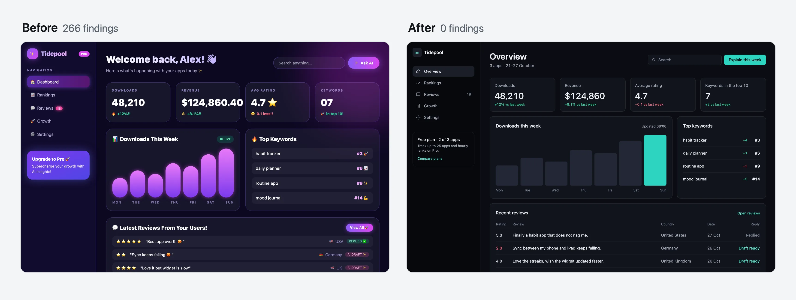
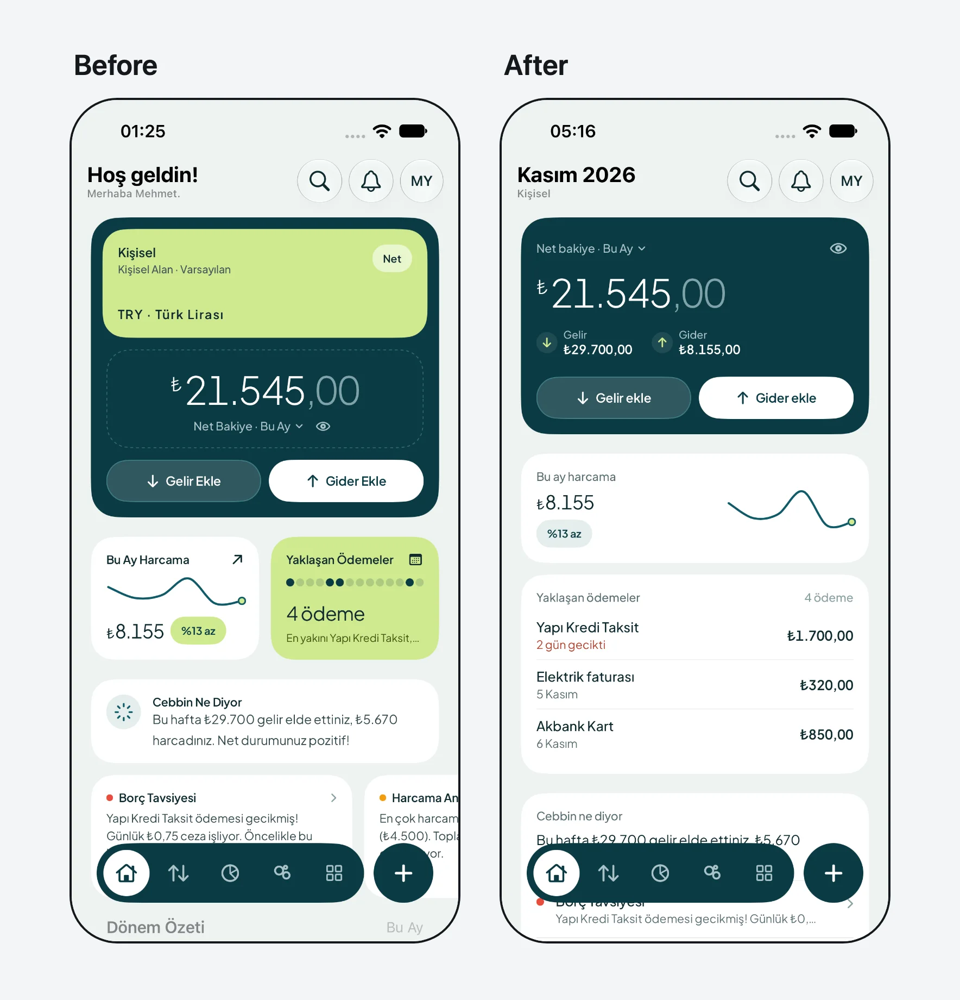

# ai-design-check

**Find what makes an AI-built interface look generated, fix it, and keep it from coming back.**

[](https://www.npmjs.com/package/@enmera/ai-design-check)
[](LICENSE)
[Türkçe](README.tr.md) · [日本語](README.ja.md)

For anyone building with Claude Code, Cursor or Codex: 147 design rules, a checker with no dependencies and no API key, and
an agent skill that repairs the screen. It reads web projects (React, Vue, Svelte, Laravel Blade, HTML; Tailwind, Bootstrap or plain
CSS) and SwiftUI, Jetpack Compose, Flutter and React Native apps. Finding needs no agent, and neither do the mechanical fixes.

## Start in three steps

**1. Check your project.**

```bash
npx @enmera/ai-design-check
```

```
Accessibility (1)
src/pages/dashboard.tsx
     31  error  Never remove the focus ring without a replacement: outline-none  focus-ring-removed

Style (3)
src/pages/dashboard.tsx
     42  error  Font sizes from the scale only: text-[10px]  type-scale
     88  warn   No tracked uppercase labels: tracking-wide uppercase  no-decorative-uppercase

lang/tr.json
    812  error  Translation in Title Case: "Sıra Takibi" (Rank tracking)  sentence-case

1 accessibility, 3 style: 3 errors, 1 warnings, 0 notes.
```

**2. Fix what has one answer, with no agent.**

```bash
npx @enmera/ai-design-check --fix --dry-run
```

This lists the changes; drop `--dry-run` to make them. Spacing and corners move to the nearest step of your scale, and very
heavy type becomes bold. Tap sizes, colours, emoji, words and hierarchy stay in the report, since they take a decision.
Add `--nearest-type` to move `text-[Npx]` sizes to the nearest theme size as well (`lg:text-[64px]` → `lg:text-6xl`).

**3. Let your agent fix the rest.**

```bash
npx skills add enmerasoftware/ai-design-check
```

Then ask: *"fix the design of this screen"*. The agent measures the screen, writes a short brief from your product, repairs
it, and shows the count before and after. Features, data and words stay.

<p align="center">
  
</p>
<p align="center"><sub>The same dashboard, before and after. Open <a href="examples/dashboard.html">before</a> and <a href="examples/dashboard.fixed.html">after</a>, or watch <a href="examples/story-dashboard.mp4">the video</a>.</sub></p>

## What's in the package

| Tool | What it answers | Run it |
|---|---|---|
| **Checker** | What is wrong, in which file and on which line? | `npx @enmera/ai-design-check` |
| **Fix skill** | Can an agent repair this screen and prove it? | `npx skills add enmerasoftware/ai-design-check` |
| **`scan`** | What does the running page really show? Contrast, sizes, what covers what, script errors | `npx @enmera/ai-design-check scan http://localhost:3000` |
| **`redesign`** | Can my agent study this page and redo it on a branch, proving each step? | `npx @enmera/ai-design-check redesign http://localhost:3000` |
| **`inventory`** | How many different buttons, inputs, headings and cards do we have? | `npx @enmera/ai-design-check inventory` |
| **`narrow`** | What breaks on a phone or in a long language? | `npx @enmera/ai-design-check narrow page.html` |
| **`system`** | What fonts, type and colours should a new product start with? | `npx @enmera/ai-design-check system --brand "#1E5A63"` |
| **`story`** | Can I share the change as a video? | `npx @enmera/ai-design-check story before.html after.html` |

## What it catches

68 rules read your code (34 of them in app code too) and 61 read the running page (`scan`), some of them both. The other 33 need eyes on the screen, so they
are marked *review* and left to you and the fix skill. Each rule says what to do, why and how to fix it, in English and Turkish: [RULES.md](RULES.md).

| Area | Examples |
|---|---|
| Accessibility | Focus rings never removed without a replacement, icon-only buttons have a name, tap targets |
| Phone browsers | Pinch zoom stays on, 16 px text in fields, `dvh` beside fixed `100vh`, nothing hidden until hover |
| Type and shape | One type scale with 11 px as the floor, one radius per level, no cards inside cards |
| Writing and copy | Sentence case, no tracked uppercase labels, no buzzwords, buttons that say what they do, errors that say what to do |
| Components | Buttons and inputs from shared components, no outside styling, repeated markup becomes a component |
| Layout | Spacing on a 4 px grid with one gap per level, wide tables span the page, room for each cell on a phone |
| Visual language | Line icons instead of emoji, no gradient text or purple gradients, no side stripes, no coloured shadows, glow only in charts |
| Motion | No `transition-all`, no bounce, reduced motion respected, pulse only for live data, answers within 300 ms, no endless loops |
| Data | Numbers carry their comparison, tabular numerals, empty states |
| Localisation | Locale-aware case changes (Turkish i/İ), numbers through the formatter, real plurals |
| Selectors and navigation | One selector language, menu grouped by job, moved URLs redirect |

The rules come from screens we shipped at [Enmera](https://enmera.com.tr) and [Searvia](https://searvia.com): what read as
generated, what broke at narrow widths, what people did not understand. We then compared them with 16 highly rated
dashboard designs. Method and findings: [RESEARCH.md](RESEARCH.md).

**How well it tells them apart.** [BENCHMARK.md](BENCHMARK.md) runs every rule on 72 pages that four Claude and two
GPT models generated, in Tailwind and in Bootstrap, and on 34 sites people designed. Some rules separate the two clearly: a
cream page ground shows on 40% of the AI pages against 3% of the sites; on phones 35% of the AI pages scroll sideways and no
human site does. GPT and Claude leave different marks: GPT pages set small text on every page and crush heading letter
spacing on 88% of them. Others no longer tell, purple gradients among them, and their severity follows that evidence.

## The running page and the redesign

`scan` opens the page in your Chrome at desktop and phone width, with no model and no API key. It reads what the source can't
show: real contrast, sizes, what covers what, broken images, script errors, content that never appears. It reads every colour
Chrome computes, Tailwind 4's `oklch()` included, and the habits of a generated page: an accent word in the headline,
coloured shadows, an arrow on every call to action, lists strung on middle dots, a badge pill above the headline.

A page that did not load, answers with an error, sends the browser to a sign-in page or draws a sign-in form in its own place
stops the scan with exit 2 instead of passing as clean. For a page behind a sign-in, pass `--cookie "name=value"` or `--header "Name: value"`, or set
`AI_DESIGN_CHECK_COOKIE` and `AI_DESIGN_CHECK_HEADERS` to keep them out of shell history and CI logs. Both go only to the
page's own origin, never to the other hosts it loads from. `--allow-redirect` and
`--allow-status 404` check such a page on purpose. Several URLs are scanned in one run. Add `--format github`
for pull requests. With `designSystem` in the config (`fonts`, `sizes`, `radii`, `colors`) it also names what drifts.

To check one part of a page, such as a CMS module rendered inside the app's own shell, pass
`--scope "[data-block-type=module-1]"`: only what is inside a match is checked, and `redesign` measures and plans only that
part. `--ignore "nav"` leaves a part out. Both work for `scan`, `narrow` and `redesign` and can be given more than once;
several scopes are one area. A scope that matches nothing stops the run with exit 2 instead of passing as clean. Sideways
scrolling caused outside the scope is not reported; script errors are, since they belong to the whole page. Text under `aria-hidden="true"`,
such as a faded code rain behind the headline, is decoration: contrast, size and the other reading rules leave it alone,
while the visual tells (gradients, glows, endless loops) still look at it.

`redesign` is the one part that needs your agent (Claude Code or Codex), because deciding what a page should show takes
judgement. The agent studies the screenshots, the code and the subject, and writes one card per section: what it says, what
is wrong, the idea that comes from its own content, the colours it uses from your site. Those cards are checked against the
measured page. Then the numbered fixes and the cards are applied pass by pass on a new git branch, and a pass that loses
content, adds rule errors or looks worse is thrown away. `--plan` stops after the cards so you can read and edit them;
`--brief` builds them. It starts only on a clean working tree (commit or stash first), and Ctrl-C puts back the pass in
progress.

Before any card the study decides how much to change: `heavy` (many tells, rebuilt section by section), `polish` (mostly
designed: at most two sections change the look, each on a measured tell, and bigger ideas become suggestions) or `none`
(it works; a few refinements are suggested and nothing is built). Then it writes a direction from your product: what it is
in one sentence, its character in two or three concrete words (not clean, modern, sleek, minimal or premium), the world
it belongs to, the one or two moments on the screen that carry the richness, and one signature detail. Each card says
whether it changes the look, and what a visitor will see differently; `--plan` and `BRIEF.md` label every card "changes
the look" or "fixes only" and say so in one line when none changes it. The first screen's card has to change the look and
show the proof of its claim. After the craft pass the visual check asks, card by card, whether that change is in the after
screenshot; a card that looks the same gets one more try, then the pass is thrown away. A `brief.json` from an earlier
version still works with `--brief`, as `heavy` with no direction.

`--in-place` makes no branch and no commits, and runs on a tree with uncommitted work (yours, or another session's): a pass
that is thrown away goes back to exactly the state before it, your edits included, and a kept pass stays as uncommitted
changes with its patch saved, so `git apply -R <patch>` undoes it; the run ends with the changed files and the undo
commands, newest first. `--files "resources/views/home.blade.php,resources/css/**"` limits every pass to those paths or
globs: a pass that changes any other file is thrown away. `--out <dir>` puts the plan, screenshots, logs and patches
somewhere else (default `.ai-design-check/redesign`, which git ignores; a folder outside the project works too). For a
page behind a sign-in when you would rather not hand over a cookie, save it and pass the file: `redesign ./page.html` (or
`--html page.html`). With `--build "<command>"` the passes edit your sources and the command writes the file again; without
it the passes edit the file itself, and a file git does not keep is put back from a copy when a pass is thrown away.

The study starts from what you already know. A `PRODUCT.md` in the project root (purpose, audience, voice, what to
avoid, rivals) and a `DESIGN.md` (the visual system you keep) go into the study and the craft prompt, quoted as your notes;
`--product <file>` and `--design <file>` point elsewhere. Without a `PRODUCT.md` the study writes a draft to the `--out`
folder from the README, the package description and the pages, and the run says in one line to review it and move it to
the root; the tool never writes there itself. `--intent "<text>"` says what you want from this run: it leads the study and
the cards, and is kept in `brief.json`. `--degree heavy|polish|none` chooses how far the run goes instead of leaving it
to the study, which then has to write that degree (a `--brief` brief takes it). Heavy rebuilds every section that is not
kept, composes the first screen as one picture with a real product surface, turns repeated identical cards into
content-specific pictures and keeps the logo, brand colour, fonts, words and section order; its cards may use tints and
shades of the site's colours (the same hue within 8 degrees, or a neutral grey), while polish and none use exactly the
site's colours. `--images openai|gemini` lets cards ask for generated photos or illustrations (a hero scene,
one photo per sector in place of identical icon cards): at most 1 per card and `--images-max` per run (default 6, up to
12). The key is read from `OPENAI_API_KEY` or `GEMINI_API_KEY` only and never printed; a missing one stops the run
before any agent starts. After the study the run lists each image with an estimated cost (an estimate: check your
provider's pricing) and generates nothing without a yes at the terminal or `--yes`. The images go to
`<out>/images/`, and the craft pass copies them into the page's own image folder with real alt text. Any other field you put in `product` (`context`, `audience`, `voice`,
`competitors`, `avoid`, or one of your own) reaches both prompts. Each card that changes the look picks a layout from its
content (`split`, `product`, `photo`, `place`, `editorial`, `statement`, `collage`, or `centred` for a short section with
no visual) with a line saying why; a centred hero with a visual, or two changing sections side by side with one layout, is
sent back. `"only": ["exact heading"]` in `brief.json` limits the work to those sections, and the rest stays untouched. A
card may list `addsText` and `replacesText` (`{ "from": "text on the page", "to": "new text" }`); those are the only text
changes a pass may make. Before anything is applied the run prints the degree, direction, intent and cards; at a terminal
it asks `Apply these passes? [y/N]` and stops with nothing changed unless you say yes, printing the command that goes on
(`--brief <out>/brief.json --yes`). Agents and CI get the summary and the run goes on.

For a page that only exists once a command draws it, such as a CMS module behind a sign-in written into static HTML:
`redesign module-1.html --serve dist --render "php artisan module:export 1"`. `--serve <dir>` serves that folder on
127.0.0.1 at a free port (no listing, nothing outside it) and the page is a path inside it; `--render "<command>"` runs
before the first measurement and after every pass, after `--build`, and a failure throws the pass away as a failed build
does. `--build-minutes <n>` sets the time limit for both (default 10).

Work that is thrown away stays within reach. Every run ends with `compare.html` in the `--out` folder: each pass's before
and after screenshots side by side, whether it was kept or thrown away and why. A thrown-away pass leaves
`pass-N-<name>.rejected.patch`, and `npx @enmera/ai-design-check redesign apply <patch>` puts it into the working tree
(3-way when it no longer fits as it is; a patch that does not apply cleanly changes nothing) and prints the files and the
undo command. The word check counts only reading text: text under `aria-hidden="true"`, or in a positioned layer that
takes no clicks (`pointer-events: none`, behind the content), is decoration a pass may replace. A card whose idea replaces,
removes or rewrites visible text has to list it in `addsText` or `replacesText`, or the study is sent back. The pass
prompts carry the `shot` command for the page (the served address with `--serve`) and, with `--build` or `--render`, the
command that draws it again, so the agent looks at its own work before it reports. When a test forbids what a card asks
for, the agent changes that test and names it; tests a pass changed are listed apart in the log, the summary and
`result.json` (`testsChanged`).

## Mobile apps

Point it at the app folder. It reads SwiftUI and Jetpack Compose: spacing off the scale (4 pt unless `spacing` is set; `.padding(13)`, `10.dp`), radii
off the scale, fixed text that ignores Dynamic Type, heavy headings, purple gradients, `sparkles` for AI, emoji in strings,
Title Case labels, heavy shadows, big blurs, looping animations, and tap targets under 44 pt / 48 dp.

```bash
npx @enmera/ai-design-check Cebbin/Views
```

<p align="center">
  
</p>
<p align="center"><sub>Our iOS app Cebbin, live on the App Store, on the simulator with the same data. <a href="examples/redesign-cebbin-swiftui.mp4">Watch the 16 fixes</a>, each with the SwiftUI line behind it, or <a href="examples/story-cebbin-swiftui.mp4">the first run</a> from 23 findings to 0.</sub></p>

## Use it in your project

### Give your agent the rules

The package ships two skills, both installed by `npx skills add enmerasoftware/ai-design-check`:

- **ai-design-check** has the agent read the rules before touching a screen and run the checker afterwards.
- **ai-design-fix** repairs a screen that already looks generated. It measures gaps and radii, writes a four-line brief (job,
  claim, proof, keep), works through the screen in order of harm, and reports before and after. It never removes content
  to lower the count, and never silences a finding without a reason.

In Claude Code the same skills install as a plugin: `/plugin marketplace add enmerasoftware/ai-design-check`, then
`/plugin install ai-design-check@ai-design-check`. In Codex: `codex plugin marketplace add enmerasoftware/ai-design-check`.

Without skills, point your agent's instructions (`CLAUDE.md`, `AGENTS.md`, `.cursor/rules`) at
`node_modules/@enmera/ai-design-check/RULES.md`.

### Show findings right after each edit

A hook checks the file an agent just changed and hands the findings back to it. In Claude Code's `.claude/settings.json`:

```json
{
    "hooks": {
        "PostToolUse": [
            { "matcher": "Edit|Write|MultiEdit", "hooks": [{ "type": "command", "command": "npx -y @enmera/ai-design-check hook" }] }
        ]
    }
}
```

The same command works for any agent hook that passes `tool_input.file_path` or `file_path` as JSON on stdin. A clean file
exits silently; findings exit 2 on stderr.

### Add it to CI

```yaml
- run: npx @enmera/ai-design-check
```

It exits 1 on errors, and on warnings too with `--strict`. It exits 2 when nothing could be checked or an option or the config
is wrong, so a mistyped path cannot pass. `--json` prints for machines, and `--format github` writes pull
request annotations.

### Start from an existing project

Record today's findings, and from then on only new ones are reported:

```bash
npx @enmera/ai-design-check --write-baseline
```

Ignore one place, always with a reason after `--`. An ignore without a reason does not count:

```tsx
{/* ai-design-check-ignore-next-line type-scale -- hero display size, see DESIGN.md */}
// ai-design-check-ignore-file use-shared-components -- this file is the Button component
```

Among JSX children the comment goes in braces, as above. Directly after `=> (` or `return (` there are no children
yet, so `{/* */}` there breaks the JSX: use a `//` line comment instead.

```tsx
{items.map((item) => (
    // ai-design-check-ignore-next-line type-scale -- hero display size, see DESIGN.md
    <h2 className="text-[56px]">{item.title}</h2>
))}
```

On a running page (`scan`), mark the element instead. A finding on it or inside it is not reported for the rules listed,
separated by spaces; `*` or an empty value means every rule:

```html
<div class="faq" data-ai-design-check-ignore="no-invisible-content text-not-covered">…</div>
<section data-ai-design-check-ignore="*">…</section>
```

## Commands

### `inventory`: one look per element

```
Buttons  726 uses · 149 different looks · 147 without a shared component
   115×  <Button variant=outline size=sm>                       src/pages/projects/show.tsx:212
     9×  <button> bg-brand-400 font-semibold px-4 py-2 rounded-full text-on-brand text-sm   src/pages/home.tsx:91
Headings  229 uses · 69 different looks · 229 without a shared component
```

Use it before a cleanup to see the drift and afterwards to see it gone. Layout classes are ignored, so two copies that differ
only in where they sit count as one look.

### `narrow`: phones and long languages

```bash
npx @enmera/ai-design-check narrow examples/narrow-de.html --width 320
```

Renders the page in your Chrome at phone and desktop width and reports what only a rendered page shows: sideways scrolling
and what causes it, text cut off, text shrunk to fit, and content hidden on phones. Run it with your longest language; German
labels are often 30–40 % longer than English. Try [the broken example](examples/narrow-de.html) and
[the fixed one](examples/narrow-de.fixed.html).

Add `--stress` to run it again with worst-case data: long names, large numbers and text 40 % longer. It tests the layout;
grammar such as "1 member" still needs a look at the screen with real data.

### `system`: a design system from your brand

```bash
npx @enmera/ai-design-check system --character calm --brand "#1E5A63" --kind app --out design-system
```

For a new product or one with no tokens. Give it a character (`calm`, `precise`, `friendly`, `warm`, `bold`, `editorial`,
`luxurious`, `playful`, `technical`, `trustworthy`), a brand colour and a kind of screen (`dashboard`, `app`, `marketing`,
`reading`).

| You get | Details |
|---|---|
| Fonts | UI, display, numbers and code, from a library of 50. `fonts --character calm` lists the options |
| Type scale | Eight roles that map to Dynamic Type and Material 3 |
| Colours | Light and dark; every text and background pair passes WCAG 2 at 4.5:1, status pills and buttons included |
| Shape | A 4 px spacing scale, radii that nest, control heights, card padding |
| Files | `tokens.css`, Tailwind `theme.css`, Bootstrap `bootstrap.css` and `_variables.scss`, `tokens.json`, `DesignSystem.swift`, `DesignSystem.kt`, `preview.html` |

With Bootstrap 5.3, link `bootstrap.css` after Bootstrap's own CSS: light is the default and dark applies under
`data-bs-theme="dark"`. It also replaces the blue Bootstrap compiles into fields, checks, menus, pagination and the rest. A
build from source imports `_variables.scss` before Bootstrap.

### `shot`: look at a page

```bash
npx @enmera/ai-design-check shot http://localhost:3000 --width 390 --out look.png --full
```

One screenshot as Chrome draws it, and nothing changed: for an agent to look at its own work after an edit. `--full` takes
the whole page, `--scope` clips to that part and `--ignore` hides one; `--cookie` and `--header` work as for `scan`.

### `story`: a before/after video

```bash
npx @enmera/ai-design-check story screen.before.html screen.html --out story.mp4 --music track.mp3 --still frame.png
```

A square 12 second video: every finding marked one by one, a wipe to the new screen while the count falls, and an end card.
It takes files or URLs, and needs only your Chrome and ffmpeg.

`--style swarm` tells the change another way: labelled agents (layout, type, colour) fly over the new screen, frame
each block with its live size, type the headings and text in and build the rest, while the count falls
([example](examples/story-dashboard-swarm.mp4)).

### Other commands

```bash
npx @enmera/ai-design-check rules    # list the rules (--tr for Turkish)
npx @enmera/ai-design-check init     # write a config with the defaults
```

<details>
<summary><strong>Configuration</strong></summary>

`ai-design-check.json` (or `.design-rules.json`) in the project root:

```json
{
    "include": ["resources/js", "lang"],
    "ignore": ["resources/js/vendor/**"],
    "i18n": { "files": ["lang/*.json"], "keysAreSource": true, "framework": ["Reset Password"] },
    "properNouns": ["Brand Studio", "Core Web Vitals", "Privacy Policy"],
    "componentDirs": ["**/components/ui/**"],
    "components": { "button": "Button", "input": "Input" },
    "sharedComponents": ["Button", "Badge", "Input", "Card"],
    "looks": { "badge": "StatusBadge", "card": "Tile or SectionCard", "heading": "Heading", "link": "LinkButton" },
    "rules": { "pulse-for-live-only": "off" },
    "spacing": { "base": 6 },
    "allow": {
        "type-scale": ["src/marketing/hero.tsx:text-[44px]"],
        "glow-in-charts-only": ["src/components/charts/**"]
    }
}
```

| Key | Meaning |
|---|---|
| `i18n.files` | JSON dictionaries. With `keysAreSource` the keys are the English source and are checked too. `framework` lists keys you cannot rename |
| `properNouns` | Names that keep their capitals |
| `allow` | Per rule, `"glob"` or `"glob:exact match"` |
| `spacing` | The spacing scale: `6`, `[4, 6, 8, 12]` or `{ "base": 4, "values": [18], "native": { "base": 8 } }`. See below |
| `rules` | `"off"`, `"info"`, `"warn"` or `"error"` per rule id |
| `componentDirs` | Where raw `<button>` and `<input>` are allowed |
| `components` | Raw element → the shared component to use instead |
| `sharedComponents` | Components whose look comes from props; `className` may only place them |
| `looks` | The component that owns each hand-written look. `false` turns one kind off |

**Spacing scale.** `spacing-scale` judges a value against the first of these it can read, and the report names which one it
used:

1. `spacing` in the config file.
2. Tailwind 4 `@theme`: `--spacing` is the grid, `--spacing-*` add steps.
3. `tailwind.config.*`, read as text and never run: `theme.spacing` replaces the steps, `theme.extend.spacing` adds to the
   4 px grid. A function, a variable, a spread or a preset cannot be read that way.
4. Bootstrap's `$spacer` and `$spacers` in your SCSS, read as text: their steps join the 4 px grid.
5. `:root` variables: `--spacing` is the grid, `--space-*` and `--spacing-*` add steps to the 4 px grid and never remove any.
6. The 4 px grid.

A source that exists but cannot be read (`calc()`, `clamp()`, two files that disagree, a root font size that is not one
number) leaves the 4 px grid and a note in the report. It is not guessed, and later sources are not tried. Set `spacing` to
decide it yourself. With a list and no `base`, margins, paddings and gaps must be on the list; widths, heights and offsets
only have to fit the list's common divisor.

App code (SwiftUI, Compose, Flutter, React Native) uses `spacing` from the config file (`native` when it differs from the web)
or 4 pt/dp. It reads nothing else: constants in app code have no shared place to look, and a web theme next to an app says
nothing about the app.

</details>

<details>
<summary><strong>What the checker reads</strong></summary>

`.tsx`, `.jsx`, `.vue`, `.svelte`, `.html`, Blade, CSS and SCSS, i18n JSON, SwiftUI (`.swift`) and Jetpack Compose (`.kt`). It
runs on plain Node 20+. Class rules read class strings only (`class`, `className`, `cn()`, `clsx()`, `cva()`, `twMerge()`), so
comments and copy do not match; they know Tailwind's classes and Bootstrap's. CSS rules read stylesheets, `<style>` blocks and
`style=""` attributes declaration by declaration. A framework's own stylesheet copied into the project (Bootstrap, Tailwind's
output and others, known by their licence banner) is skipped: its values are the framework's choices, not yours.

</details>

<details>
<summary><strong>Adding a rule</strong></summary>

Rules live in [`rules.json`](rules.json): `id`, `area`, `severity`, and `title`, `rule`, `why` and `fix` in `en` and `tr`, plus an
optional `check`:

- `class`: a pattern on class strings (or a list of them), with `unless`, `with`, `exceptElements`, `unlessBefore`, and `css`:
  a pattern on stylesheets, or entries read declaration by declaration (`property`, `value`, `scale`, `gradient` with `hue`,
  `selector`, `unless`, `unlessRule`)
- `native`: one pattern per platform under `swift` and `kt`, with `notMultipleOf`, `min`, `max`, `unlessBefore`, `unlessAfter`
  and `onlyIf`
- `regex`: a pattern on code with comments excluded, with `flags` and `files`
- or a structural check

Run `npm run docs` to regenerate RULES.md and RULES.tr.md, and `npm test` before opening a pull request.

</details>

## License

MIT
