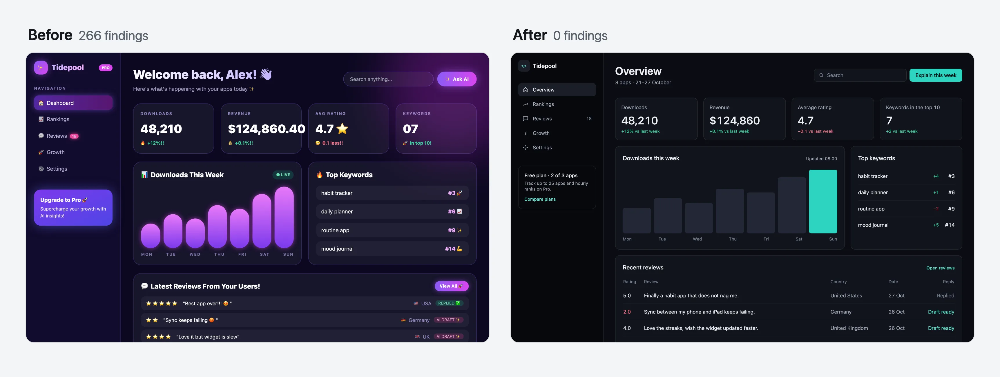
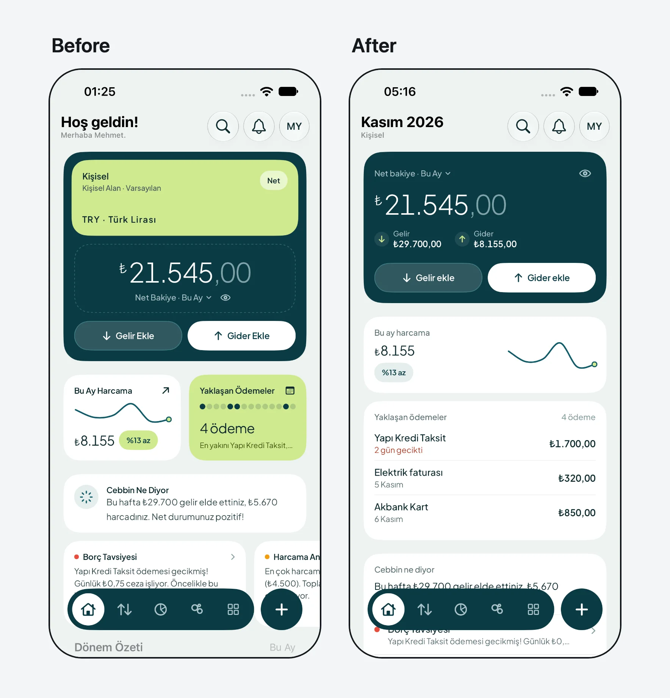

# ai-design-check

**Yapay zekâ ile yapılmış arayüzü "üretilmiş" gösteren şeyleri bulur, düzeltir ve geri gelmesini engeller.**

[](https://www.npmjs.com/package/@enmera/ai-design-check)
[](LICENSE)
[English](README.md)

Claude Code, Cursor ya da Codex ile geliştirenler için: 95 tasarım kuralı, bağımlılık ve API anahtarı gerektirmeyen bir
denetçi ve ekranı onaran bir ajan becerisi. Web projelerini (React, Vue, Svelte, Laravel Blade, HTML) ve SwiftUI, Jetpack
Compose, Flutter, React Native uygulamalarını okur. Bulmak için ajan gerekmez, mekanik düzeltmeler için de gerekmez.

## Üç adımda başlayın

**1. Projenizi denetleyin.**

```bash
npx @enmera/ai-design-check
```

```
Accessibility (1)
src/pages/dashboard.tsx
     31  error  Never remove the focus ring without a replacement: outline-none  focus-ring-removed

Style (3)
src/pages/dashboard.tsx
     42  error  Font sizes from the scale only: text-[10px]  type-scale
     88  warn   No tracked uppercase labels: tracking-wide uppercase  no-decorative-uppercase

lang/tr.json
    812  error  Translation in Title Case: "Sıra Takibi" (Rank tracking)  sentence-case

1 accessibility, 3 style: 3 errors, 1 warnings, 0 notes.
```

**2. Tek cevabı olanı ajansız düzeltin.**

```bash
npx @enmera/ai-design-check --fix --dry-run
```

Bu komut değişiklikleri listeler; yazmak için `--dry-run` bayrağını kaldırın. Boşluk ve köşeler ölçeğinizin en yakın
basamağına gider, çok kalın yazı kalına iner. Dokunma alanı, renk, emoji, metin ve hiyerarşi karar istediği için raporda kalır.

**3. Kalanı ajanınıza bırakın.**

```bash
npx skills add enmerasoftware/ai-design-check
```

Sonra şunu yazın: *"bu ekranın tasarımını düzelt"*. Ajan ekranı ölçer, ürününüzden kısa bir özet çıkarır, ekranı onarır ve önce
ile sonraki sayıları gösterir. Özellikler, veriler ve metinler yerinde kalır.

<p align="center">
  
</p>
<p align="center"><sub>Aynı panel, önce ve sonra. <a href="examples/dashboard.html">Önceki</a> ve <a href="examples/dashboard.fixed.html">sonraki</a> hali açın ya da <a href="examples/story-dashboard.mp4">videoyu</a> izleyin.</sub></p>

## Pakette neler var

| Araç | Yanıtladığı soru | Çalıştırma |
|---|---|---|
| **Denetçi** | Sorun ne, hangi dosyada, hangi satırda? | `npx @enmera/ai-design-check` |
| **Düzelten beceri** | Ajan bu ekranı onarıp kanıtlayabilir mi? | `npx skills add enmerasoftware/ai-design-check` |
| **`inventory`** | Kaç farklı düğme, form öğesi, başlık ve kart var? | `npx @enmera/ai-design-check inventory` |
| **`narrow`** | Telefonda ya da uzun bir dilde ne bozuluyor? | `npx @enmera/ai-design-check narrow sayfa.html` |
| **`system`** | Yeni bir ürün hangi yazı tipi, ölçek ve renklerle başlamalı? | `npx @enmera/ai-design-check system --brand "#1E5A63"` |
| **`story`** | Değişikliği video olarak paylaşabilir miyim? | `npx @enmera/ai-design-check story once.html sonra.html` |

## Neleri yakalar

Denetçi 57 kuralı otomatik sınar. Kalan 38 kural ekrana bakmayı gerektirir; *gözden geçirilecek* olarak işaretlenir ve size ve
düzelten beceriye bırakılır. Her kural ne yapılacağını, nedenini ve nasıl düzeltileceğini Türkçe ve İngilizce anlatır:
[RULES.tr.md](RULES.tr.md).

| Alan | Örnekler |
|---|---|
| Erişilebilirlik | Odak halkası yerine başkası konmadan kaldırılmaz, yalnız ikonlu düğmenin adı olur, dokunma alanları |
| Telefon tarayıcıları | İki parmakla yakınlaştırma açık kalır, alanlarda 16 px yazı, sabit `100vh` yanında `dvh`, üzerine gelmeden görünmeyen içerik yok |
| Yazı ve biçim | En küçüğü 11 px olan tek yazı ölçeği, düzey başına tek köşe, kart içinde kart yok |
| Yazım ve metin | Yalnız ilk kelime büyük, aralıklı büyük harfli etiket yok, boş söz yok, ne yaptığını söyleyen düğme, ne yapılacağını söyleyen hata |
| Bileşenler | Düğme ve form öğeleri ortak bileşenden, dışarıdan biçim yok, tekrarlanan kod bileşene dönüşür |
| Yerleşim | Projenin ölçeğinde (okunamazsa 4 px) düzey başına tek boşluk, geniş tablolar sayfayı kaplar, telefonda her hücreye yer |
| Görsel dil | Emoji yerine çizgi ikon, gradyan yazı ve mor gradyan yok, yan şerit yok, parıltı yalnız grafikte |
| Hareket | `transition-all` yok, sıçrama yok, hareket azaltma ayarına uyum, nabız yalnız canlı veride, yanıt 300 ms içinde, sonsuz döngü yok |
| Veri | Sayı neyle kıyaslandığını söyler, sabit genişlikte rakamlar, boş durumlar |
| Yerelleştirme | Dile uygun büyük/küçük harf (Türkçe i/İ), biçimlendirici ile sayılar, gerçek çoğul kuralları |
| Seçici ve menü | Tek seçici dili, işe göre gruplanmış menü, taşınan adres yönlendirilir |

Kurallar [Enmera](https://enmera.com.tr) ve [Searvia](https://searvia.com)'da canlıya çıkardığımız ekranlardan çıktı: üretilmiş
gibi görünenler, dar ekranda bozulanlar, kullanıcının anlamadıkları. Ardından yüksek puanlı 16 panel tasarımıyla karşılaştırdık.
Yöntem ve bulgular: [RESEARCH.md](RESEARCH.md).

## Mobil uygulamalar

Uygulama klasörünü verin. SwiftUI ve Jetpack Compose okur: ölçek dışı boşluk (`spacing` ayarlı değilse 4 pt; `.padding(13)`, `10.dp`), ölçek dışı köşe,
Dynamic Type'ı yok sayan sabit yazı, çok kalın başlık, mor gradyan, yapay zekâ için `sparkles`, metinde emoji, Her Kelimesi Büyük
etiket, ağır gölge, büyük bulanıklık, sürekli dönen animasyon ve 44 pt / 48 dp altı dokunma alanı.

```bash
npx @enmera/ai-design-check Cebbin/Views
```

<p align="center">
  
</p>
<p align="center"><sub>App Store'daki iOS uygulamamız Cebbin; simülatörde, aynı veriyle. <a href="examples/redesign-cebbin-swiftui.mp4">16 düzeltmeyi izleyin</a>, her birinde arkasındaki SwiftUI satırı görünür, ya da 23 bulgudan 0'a inen <a href="examples/story-cebbin-swiftui.mp4">ilk denemeye</a> bakın.</sub></p>

## Projenizde kullanın

### Kuralları ajanınıza verin

Pakette iki beceri var; ikisi de `npx skills add enmerasoftware/ai-design-check` ile kurulur:

- **ai-design-check**: ajan bir ekrana dokunmadan önce kuralları okur, sonra denetçiyi çalıştırır.
- **ai-design-fix**: üretilmiş görünen ekranı onarır. Boşluk ve köşeleri ölçer, dört satırlık özet yazar (iş, iddia, kanıt,
  korunacaklar), ekranı en zararlıdan başlayarak elden geçirir, önce ve sonrayı bildirir. Sayıyı düşürmek için içerik silmez,
  gerekçesiz bulgu susturmaz.

Beceri kullanmıyorsanız ajan talimatlarınızı (`CLAUDE.md`, `AGENTS.md`, `.cursor/rules`)
`node_modules/@enmera/ai-design-check/RULES.tr.md` dosyasına yönlendirin.

### Her düzenlemeden hemen sonra bulguları gösterin

Kanca, ajanın az önce değiştirdiği dosyayı denetler ve bulguları ona geri verir. Claude Code'da `.claude/settings.json`:

```json
{
    "hooks": {
        "PostToolUse": [
            { "matcher": "Edit|Write|MultiEdit", "hooks": [{ "type": "command", "command": "npx -y @enmera/ai-design-check hook" }] }
        ]
    }
}
```

Aynı komut, standart girdiden JSON olarak `tool_input.file_path` ya da `file_path` veren her ajan kancasıyla çalışır. Temiz dosya
sessizce çıkar; bulgular stderr'e yazılır ve çıkış kodu 2 olur.

### CI'a ekleyin

```yaml
- run: npx @enmera/ai-design-check
```

Hatalarda, `--strict` ile uyarılarda da 1 koduyla çıkar. `--json` makineler için yazdırır, `--format github` pull request
notları üretir.

### Var olan projede başlayın

Bugünkü bulguları kaydedin; bundan sonra yalnız yenileri bildirilir:

```bash
npx @enmera/ai-design-check --write-baseline
```

Bir yeri yok saymak için `--` sonrasına mutlaka gerekçe yazın. Gerekçesiz yok sayma geçerli olmaz:

```tsx
{/* ai-design-check-ignore-next-line type-scale -- tanıtım başlığı boyutu, bkz. DESIGN.md */}
// ai-design-check-ignore-file use-shared-components -- Button bileşeninin kendisi
```

## Komutlar

### `inventory`: öğe başına tek görünüm

```
Buttons  726 uses · 149 different looks · 147 without a shared component
   115×  <Button variant=outline size=sm>                       src/pages/projects/show.tsx:212
     9×  <button> bg-brand-400 font-semibold px-4 py-2 rounded-full text-on-brand text-sm   src/pages/home.tsx:91
Headings  229 uses · 69 different looks · 229 without a shared component
```

Temizlikten önce dağılmayı, sonra toparlandığını görmek için kullanın. Yerleşim sınıfları sayılmaz; yalnız konumu farklı iki kopya
tek görünüm sayılır.

### `narrow`: telefon ve uzun diller

```bash
npx @enmera/ai-design-check narrow examples/narrow-de.html --width 320
```

Sayfayı Chrome'unuzda telefon ve masaüstü genişliğinde açar, yalnız açık sayfada görülenleri bildirir: yana kayma ve nedeni,
kesilen yazı, sığsın diye küçülen yazı, telefonda gizlenen içerik. En uzun dilinizle çalıştırın; Almanca etiketler çoğu zaman
İngilizceden %30–40 uzundur. [Bozuk örneği](examples/narrow-de.html) ve [düzeltilmiş halini](examples/narrow-de.fixed.html) deneyin.

`--stress` ile en kötü veriyle yeniden çalışır: uzun adlar, büyük sayılar, %40 uzun metin. Yerleşimi sınar; "1 üye" gibi dil
bilgisi için ekrana gerçek veriyle bakmak gerekir.

### `system`: markanızdan tasarım sistemi

```bash
npx @enmera/ai-design-check system --character calm --brand "#1E5A63" --kind app --out design-system
```

Yeni ya da değişkenleri olmayan ürünler için. Bir karakter (`calm`, `precise`, `friendly`, `warm`, `bold`, `editorial`,
`luxurious`, `playful`, `technical`, `trustworthy`), marka rengi ve ekran türü (`dashboard`, `app`, `marketing`, `reading`) verin.

| Çıktı | Ayrıntı |
|---|---|
| Yazı tipleri | Arayüz, başlık, sayı ve kod için 50 yazı tipli kitaplıktan. `fonts --character calm` seçenekleri listeler |
| Yazı ölçeği | Dynamic Type ve Material 3 ile eşleşen sekiz rol |
| Renkler | Açık ve koyu; her yazı rengi WCAG 2'yi geçene kadar ayarlanır |
| Biçim | 4 px boşluk ölçeği, iç içe uyumlu köşeler, denetim yükseklikleri, kart iç boşluğu |
| Dosyalar | `tokens.css`, Tailwind `theme.css`, `tokens.json`, `DesignSystem.swift`, `DesignSystem.kt`, `preview.html` |

### `story`: önce/sonra videosu

```bash
npx @enmera/ai-design-check story screen.before.html screen.html --out story.mp4 --music track.mp3 --still frame.png
```

12 saniyelik kare video: her bulgu tek tek işaretlenir, sayı düşerken yeni ekrana geçilir, sonunda kapanış kartı gelir. Dosya ya da
adres alır; yalnız Chrome ve ffmpeg ister.

### Diğer komutlar

```bash
npx @enmera/ai-design-check rules --tr   # kuralları listele
npx @enmera/ai-design-check init         # varsayılanlarla ayar dosyası yaz
```

<details>
<summary><strong>Ayarlar</strong></summary>

Proje kökünde `ai-design-check.json` (ya da `.design-rules.json`):

```json
{
    "include": ["resources/js", "lang"],
    "ignore": ["resources/js/vendor/**"],
    "i18n": { "files": ["lang/*.json"], "keysAreSource": true, "framework": ["Reset Password"] },
    "properNouns": ["Brand Studio", "Core Web Vitals", "Privacy Policy"],
    "componentDirs": ["**/components/ui/**"],
    "components": { "button": "Button", "input": "Input" },
    "sharedComponents": ["Button", "Badge", "Input", "Card"],
    "looks": { "badge": "StatusBadge", "card": "Tile or SectionCard", "heading": "Heading", "link": "LinkButton" },
    "rules": { "pulse-for-live-only": "off" },
    "spacing": { "base": 6 },
    "allow": {
        "type-scale": ["src/marketing/hero.tsx:text-[44px]"],
        "glow-in-charts-only": ["src/components/charts/**"]
    }
}
```

| Anahtar | Anlamı |
|---|---|
| `i18n.files` | JSON sözlükleri. `keysAreSource` ile anahtarlar İngilizce kaynaktır ve onlar da denetlenir. `framework` değiştiremeyeceğiniz anahtarları listeler |
| `properNouns` | Büyük harfini koruyan adlar |
| `allow` | Kural başına `"glob"` ya da `"glob:tam eşleşme"` |
| `spacing` | Boşluk ölçeği: `6`, `[4, 6, 8, 12]` ya da `{ "base": 4, "values": [18], "native": { "base": 8 } }`. Aşağıya bakın |
| `rules` | Kural başına `"off"`, `"info"`, `"warn"` ya da `"error"` |
| `componentDirs` | Ham `<button>` ve `<input>` kullanılabilecek yerler |
| `components` | Ham öğe → yerine kullanılacak ortak bileşen |
| `sharedComponents` | Görünümü özelliklerden gelen bileşenler; `className` yalnız konumlandırır |
| `looks` | Elle yazılmış her görünümün sahibi olan bileşen. `false` o türü kapatır |

**Boşluk ölçeği.** `spacing-scale`, değeri aşağıdakilerden okuyabildiği ilkiyle karşılaştırır; rapor hangisini kullandığını
yazar:

1. Yapılandırma dosyasındaki `spacing`.
2. Tailwind 4 `@theme`: `--spacing` ızgaradır, `--spacing-*` basamak ekler.
3. `tailwind.config.*`, metin olarak okunur, asla çalıştırılmaz: `theme.spacing` basamakların yerini alır, `theme.extend.spacing`
   4 px ızgarasına ekler. İşlev, değişken, yayma (spread) ve preset bu yolla okunamaz.
4. `:root` değişkenleri: `--spacing` ızgaradır, `--space-*` ve `--spacing-*` 4 px ızgarasına basamak ekler, hiçbirini çıkarmaz.
5. 4 px ızgarası.

Var olup okunamayan kaynak (`calc()`, `clamp()`, birbirini tutmayan iki dosya, tek sayıyla anlatılamayan kök yazı boyutu) 4 px
ızgarasını bırakır ve rapora not düşer. Tahmin yürütülmez, sonraki kaynaklar denenmez. Kararı siz vermek için `spacing` ayarlayın.
`base` olmadan liste verilirse kenar, iç boşluk ve aralıklar listede olmalıdır; genişlik, yükseklik ve konumların yalnız listenin
ortak bölenine uyması yeter.

Uygulama kodu (SwiftUI, Compose, Flutter, React Native) yapılandırma dosyasındaki `spacing` değerini (web'den farklıysa `native`)
ya da 4 pt/dp kullanır. Başka bir şey okumaz: uygulama kodundaki sabitlerin bakılacak ortak bir yeri yoktur, uygulamanın
yanındaki web teması da uygulama hakkında bir şey söylemez.

</details>

<details>
<summary><strong>Denetçinin okuduğu dosyalar</strong></summary>

`.tsx`, `.jsx`, `.vue`, `.svelte`, `.html`, Blade, CSS, çeviri JSON'u, SwiftUI (`.swift`) ve Jetpack Compose (`.kt`). Düz Node 20+ ile
çalışır. Sınıf kuralları yalnız sınıf dizgilerini okur (`class`, `className`, `cn()`, `clsx()`, `cva()`, `twMerge()`), yorum ve
metinlerle eşleşmez.

</details>

<details>
<summary><strong>Kural ekleme</strong></summary>

Kurallar [`rules.json`](rules.json) içinde: `id`, `area`, `severity`, `en` ve `tr` altında `title`, `rule`, `why`, `fix` ve isteğe bağlı
`check`:

- `class`: sınıf dizgisinde desen; `unless`, `exceptElements`, `unlessBefore`, `css` ile
- `native`: `swift` ve `kt` altında platform başına desen; `notMultipleOf`, `min`, `max`, `unlessBefore`, `unlessAfter`, `onlyIf` ile
- `regex`: yorumlar hariç kodda desen; `flags` ve `files` ile
- ya da yapısal denetim

RULES.md ve RULES.tr.md için `npm run docs`, pull request öncesinde `npm test` çalıştırın.

</details>

## Lisans

MIT
